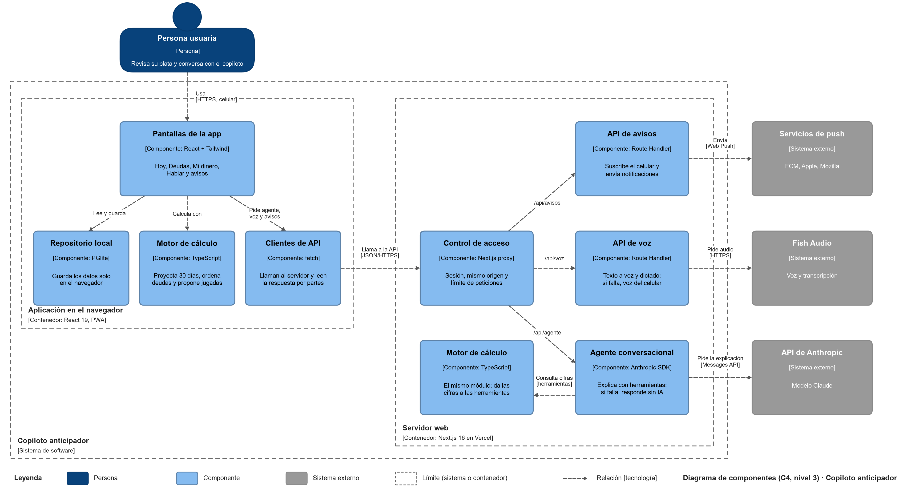

# 5 · Arquitectura

> Lámina: «Diagrama, componentes, APIs, seguridad y decisiones técnicas clave».

## 1. Diagramas

| Diagrama | Qué muestra | Archivos |
|---|---|---|
| **Componentes (C4, nivel 3): lo construido** | El prototipo tal como corre hoy: app en el navegador, servidor Next.js en Vercel y servicios externos | [`fig-componentes.png`](fig-componentes.png) · [`.pdf`](fig-componentes.pdf) |
| **Arquitectura objetivo (C4, nivel 3): propuesta** | Cómo encajaría como módulo de la app BBVA (API Gateway, core bancario, base del copiloto, registro de trazas). **No está construida** | [`fig-arquitectura-objetivo.png`](fig-arquitectura-objetivo.png) · [`.pdf`](fig-arquitectura-objetivo.pdf) |

Los diagramas se generan con matplotlib desde [`docs/diagramas/`](../../docs/diagramas/)
(`python docs/diagramas/fig-componentes.py`). Las copias de esta carpeta son las mismas imágenes.



**Dos precisiones sobre el diagrama de componentes:**

- El «Repositorio local» dice *PGlite*. Hoy los datos se guardan en **IndexedDB** del navegador; PGlite
  queda solo para recuperar una vez los casos guardados con la versión anterior
  ([`src/datos/repositorio.ts`](../../src/datos/repositorio.ts), [`src/datos/indexeddb.ts`](../../src/datos/indexeddb.ts)).
- Muestra las tres APIs principales (`/api/agente`, `/api/voz`, `/api/avisos`). La lista completa está en la sección 3.

## 2. Componentes

```
Navegador (React 19, PWA)                     Servidor (Next.js 16 en Vercel)                 Externos
┌──────────────────────────┐   JSON/HTTPS   ┌──────────────────────────────────┐
│ Pantallas (src/componentes)│ ────────────▶ │ Proxy: sesión demo (src/proxy.ts)│
│ Motor de cálculo (src/motor)│              │ Rutas /api/* (src/app/api)       │──▶ API de Anthropic (Claude)
│ Repositorio IndexedDB      │ ◀─ NDJSON ─── │ Agente + herramientas (src/agente)│──▶ Fish Audio (voz, transcripción)
│ Clientes de API (src/cliente)│             │ Motor de cálculo (mismo módulo)  │──▶ Servicios de push (Web Push)
└──────────────────────────┘                └──────────────────────────────────┘
```

| Componente | Responsabilidad | Código |
|---|---|---|
| Pantallas | Inicio, Mi ruta, Asistente, Mi dinero, Deudas, Datos de prueba, Evaluación | [`src/componentes/`](../../src/componentes/), [`src/app/`](../../src/app/) |
| **Motor de cálculo** | Única fuente de los números. El **mismo módulo** corre en el navegador (pantallas) y en el servidor (herramientas del agente), así ambos dan las mismas cifras | [`src/motor/`](../../src/motor/), [`src/ruta/`](../../src/ruta/), [`src/explica/`](../../src/explica/) |
| Repositorio local | Guarda el caso de la persona solo en su navegador; respaldo en memoria si el navegador no deja guardar; una sola pestaña escribe | [`src/datos/`](../../src/datos/) |
| Clientes de API | Llaman al servidor y leen la respuesta por partes (*streaming*) | [`src/cliente/`](../../src/cliente/) |
| Agente | Conversación con Claude y herramientas del motor (ver entregable 3) | [`src/agente/`](../../src/agente/) |
| Catálogo BBVA | Productos de BBVA Perú copiados de la web oficial, con reglas de encaje | [`src/catalogo-bbva/`](../../src/catalogo-bbva/) |
| Utilidades del servidor | Variables de entorno, sesión, mismo origen, límites de uso, registro de fallos | [`src/servidor/`](../../src/servidor/) |

## 3. APIs

Todas son *Route Handlers* de Next.js en [`src/app/api/`](../../src/app/api/). Los cuerpos se validan
con `zod` y los errores devuelven solo un código corto (nunca el mensaje del proveedor ni una traza).

| Ruta | Método | Qué hace | Mismo origen | Sesión | Límite por visitante · tope global |
|---|---|---|---|---|---|
| `/api/agente` | POST | Recibe el perfil y los mensajes; el servidor **recalcula** el análisis con el motor y responde en NDJSON por partes | Sí | Sí | 40/min · 300/h |
| `/api/voz` | POST | Texto a voz con Fish Audio | Sí | Sí | 90/min · 800/h |
| `/api/transcribir` | POST | Voz a texto con Fish Audio (`/v1/asr`) | Sí | Sí | 15/min · 300/h |
| `/api/documento` | POST | Lee una foto o PDF con Claude. **Apagada por defecto** (`LECTURA_DOCUMENTOS`); exige que la persona declare que el documento es inventado | Sí | Sí | 6/min · 120/h |
| `/api/avisos` | POST | Suscribe el celular y envía el aviso más importante. El texto lo arma el motor en el servidor; lo que mande el navegador como título o cuerpo se ignora | Sí | No | 6/min |
| `/api/ingresar` | POST | Crea la sesión de la cuenta demo (`empezar=demo|propio`) | Sí | — | — |
| `/api/salir` | POST | Cierra la sesión | Sí | — | — |
| `/api/estado` | GET | Dice qué servicios están configurados (solo `true`/`false`) | — | No | — |

Límites definidos con `crearLimite(...)` al inicio de cada ruta.

## 4. Seguridad

| Medida | Dónde |
|---|---|
| **Claves solo en el servidor**, leídas en un único archivo; nunca se registran ni se envían al navegador. `.env.local` fuera de git | [`src/servidor/entorno.ts`](../../src/servidor/entorno.ts), [`.env.example`](../../.env.example) |
| **Comprobación de mismo origen** en todas las rutas POST | `mismoOrigen` en [`src/servidor/http.ts`](../../src/servidor/http.ts) |
| **Sesión demo** con cookie aleatoria de 32 bytes, `HttpOnly`, `SameSite=Lax`, `Secure` en HTTPS. Es una puerta de prototipo, no autenticación real | [`src/servidor/sesion.ts`](../../src/servidor/sesion.ts), [`src/proxy.ts`](../../src/proxy.ts) |
| **Límites de uso** por visitante y tope global para acotar el gasto de las claves. El visitante se identifica solo con cabeceras que fija la plataforma (no `x-forwarded-for`) | [`src/servidor/limite.ts`](../../src/servidor/limite.ts), `visitante` en `http.ts` |
| **Validación de entrada** con tamaños máximos (perfil ≤ 200 KB, ≤ 1 500 movimientos, mensajes ≤ 1 000 caracteres, ≤ 20 mensajes) | [`src/servidor/perfil.ts`](../../src/servidor/perfil.ts), `src/app/api/agente/route.ts` |
| **Consentimiento:** un caso propio solo llega al proveedor de IA si la persona lo aceptó de forma expresa | `src/app/api/agente/route.ts` |
| **Defensa contra inyección en el prompt:** lo que escribe la persona va como dato limpio dentro de `<perfil>`; las instrucciones dicen que no cambian por un mensaje. Medido con preguntas tramposas (entregable 4) | [`src/agente/prompt.ts`](../../src/agente/prompt.ts) |
| **Cabeceras HTTP:** `X-Content-Type-Options: nosniff`, `X-Frame-Options: DENY`, `Referrer-Policy`, `Permissions-Policy` (micrófono solo propio; cámara y ubicación apagadas) | [`next.config.ts`](../../next.config.ts) |
| **Registro mínimo:** solo qué pieza falló y el código de estado | [`src/servidor/registro.ts`](../../src/servidor/registro.ts) |
| **Privacidad:** solo datos sintéticos; el caso de la persona vive en su navegador | [`docs/DATOS.md`](../../docs/DATOS.md) |

Auditoría de seguridad interna (14-nov): sin hallazgos altos ni críticos; 5 confirmados de severidad
baja o informativa, con su acción. Ver [`docs/auditorias/REX-SEGURIDAD-2026-11-14.md`](../../docs/auditorias/REX-SEGURIDAD-2026-11-14.md)
y el resumen en [`RESUMEN-AUDITORIAS-2026-11-14.md`](../../docs/auditorias/RESUMEN-AUDITORIAS-2026-11-14.md).

**Riesgos conocidos y aceptados para el prototipo:** la cookie de sesión solo valida su formato (no
está firmada), así que un tercero podría gastar la cuota global; `/api/avisos` no exige sesión. Ambos
están acotados por los límites de uso y anotados para después de la final.

## 5. Decisiones técnicas clave

| Decisión | Por qué | Costo aceptado |
|---|---|---|
| **El código calcula, la IA explica** | Un modelo de lenguaje puede equivocarse con una cifra; un motor con pruebas, no. La IA consulta cada número con una herramienta | Más trabajo: cada respuesta posible necesita una herramienta |
| **Motor determinista, no aprendizaje automático** | Sin datos reales no hay con qué entrenar; un método explicable se puede auditar y probar | Error a 30 días mayor que algunos métodos simples (entregable 4) |
| **Dinero en céntimos enteros y fechas sin deriva** | Evita errores de redondeo y fechas que se corren mes a mes | — |
| **Mismo motor en navegador y servidor** | Las pantallas y el agente dan exactamente las mismas cifras; el servidor recalcula y no confía en números del navegador | — |
| **Datos en el navegador (IndexedDB), sin base en el servidor** | Privacidad y cero infraestructura para la demo | No hay sincronización entre dispositivos |
| **Funciona sin claves** | Si la IA o la voz fallan en vivo, responden el motor y la voz del navegador | Respuestas menos naturales en modo respaldo |
| **Modelo elegido por el código según la pregunta** | Respuestas rápidas y baratas para lo simple; el modelo más capaz solo para planes | Reglas por expresiones regulares, con pruebas |
| **Next.js 16 en Vercel, despliegue automático de `main`** | Un solo proyecto para interfaz y API; CI en cada PR | Límite de duración por ruta (15-60 s) |

Más detalle de infraestructura, variables y plan B: [`docs/INFRAESTRUCTURA.md`](../../docs/INFRAESTRUCTURA.md).
